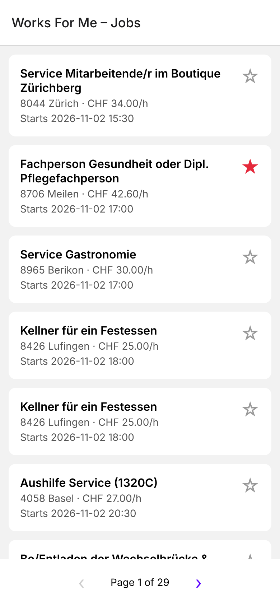
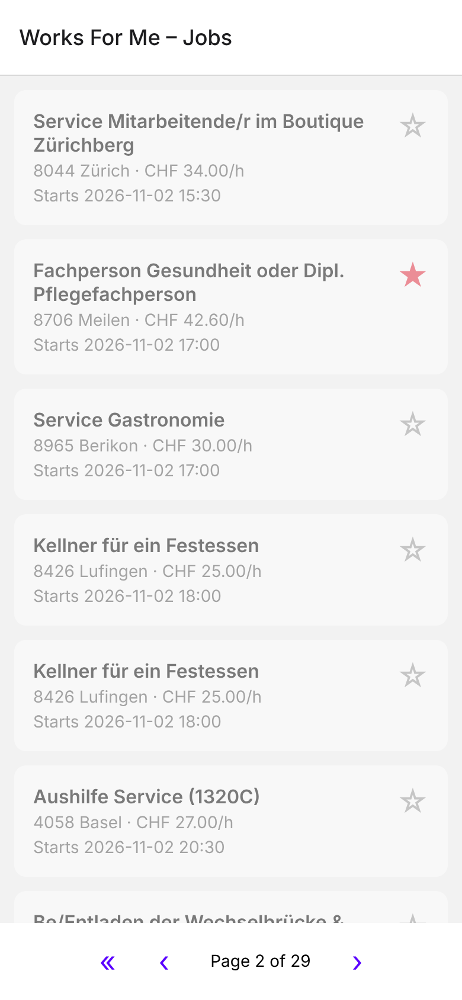
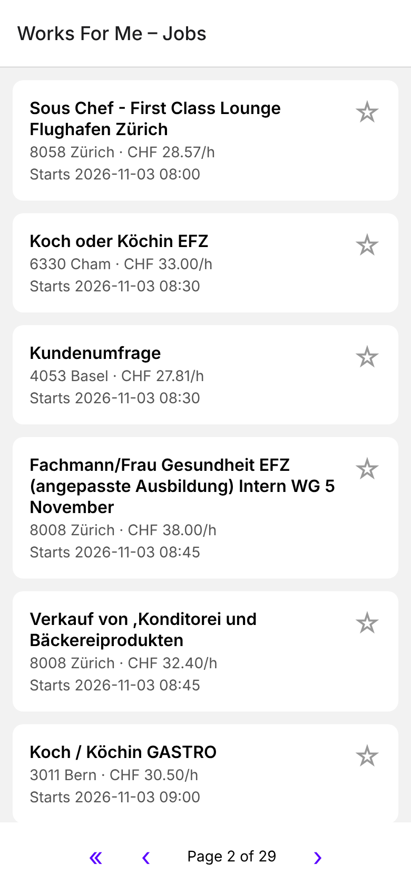
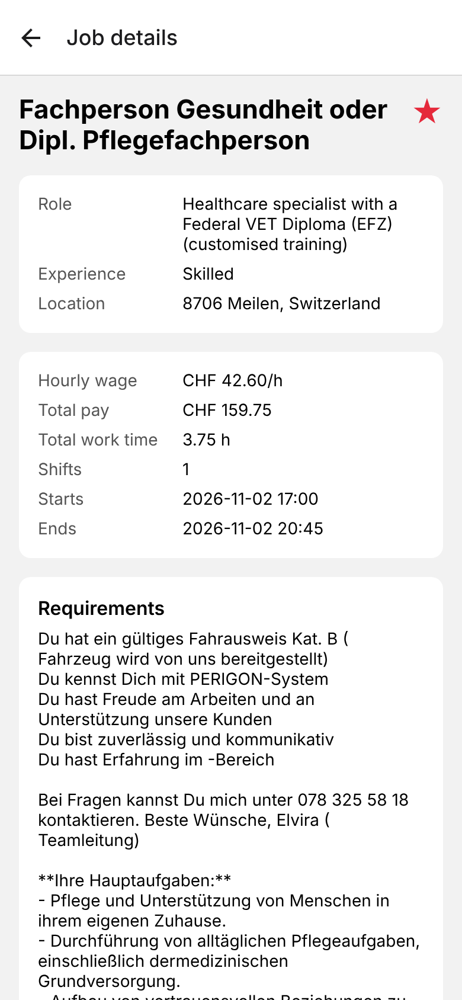
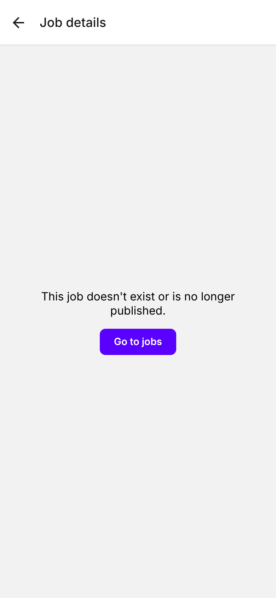
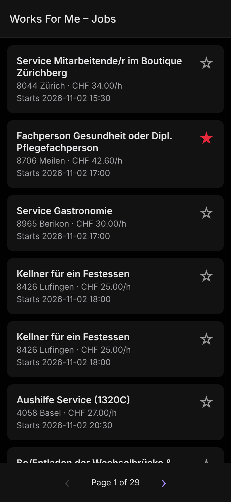
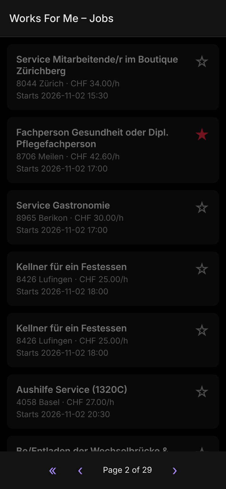
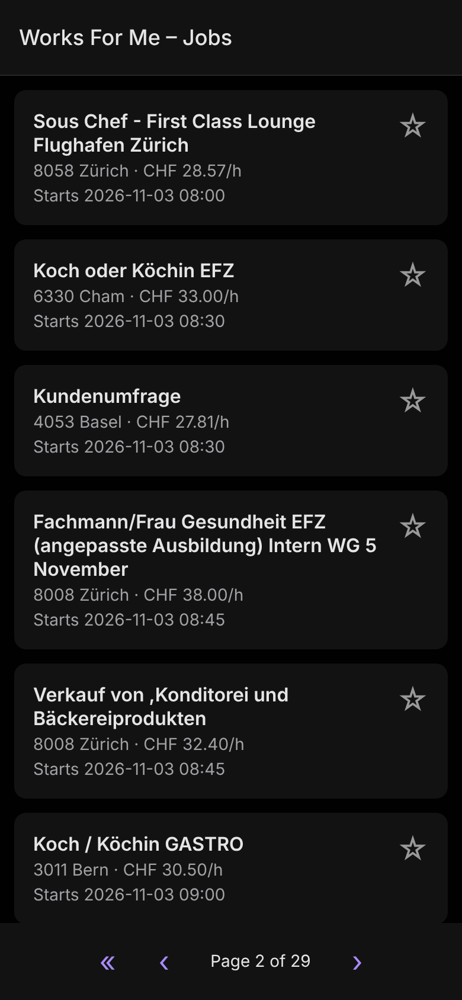
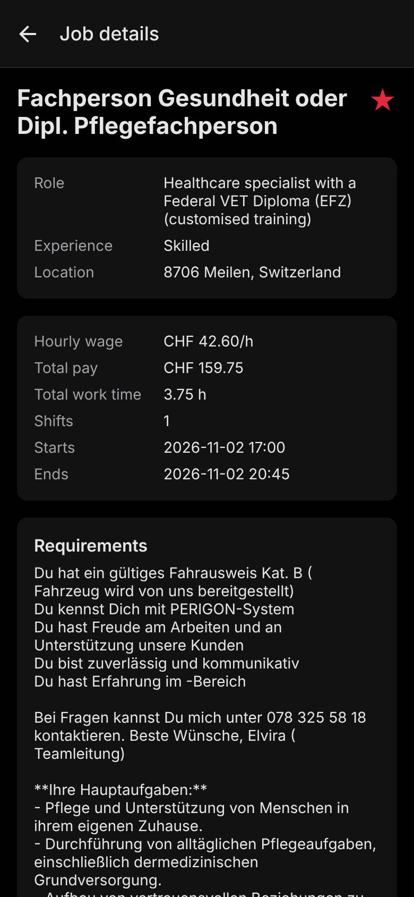

# Works For Me

Works For Me is a mobile app for browsing the public jobs listed on Coople. Open a job to see everything about it, and star the ones you like so you can find them later.

## Usage

- **Job list** shows 30 jobs per page. Use `›` / `‹` to go to the next or previous page, and `«` (shown from page 2 on) to jump back to page 1.
- **Job details** opens when you tap a job. You can also open it directly from a link to `/job/<workAssignmentId>`.
- **Favourites**: tap the star on a job in the list or on its details screen. Favourites are kept after the app restarts.
- **Dark mode** follows the phone's light or dark setting.

## Screenshots

Taken from the Expo web preview at phone size, in the light and the dark theme. In Expo Go, fonts and the header follow the platform defaults.

A screen recording of the app running in Expo Go on a phone: [Screen_Recording_20261029_193223_Expo Go.mp4](<Screen_Recording_20261029_193223_Expo Go.mp4>).

| Job list | Next page loading | Page 2 | Job details | Unknown job |
|---|---|---|---|---|
|  |  |  |  |  |
|  |  |  |  |  |

## Setup

Requirements: Node.js 22+ and the [Expo Go](https://expo.dev/go) app on your phone.

```bash
npm install
```

```bash
npx expo start
```

Scan the QR code with Expo Go (Android) or the Camera app (iOS).

To open a job from a link in Expo Go, use the address `npx expo start` prints. On a phone, open `exp://<ip>:8081/--/job/<workAssignmentId>` from a message or the browser. On a simulator:

```bash
npx uri-scheme open "exp://127.0.0.1:8081/--/job/<workAssignmentId>" --ios
```

In a standalone build the link is `worksforme://job/<workAssignmentId>`.

Checks:

```bash
npm test
```

```bash
npm run lint
```

```bash
npm run typecheck
```

End-to-end flows in `.maestro/` drive Expo Go on an Android phone over USB or an emulator, against the real API. Setup and how to run them: [docs/E2E.md](docs/E2E.md).

## Architecture

```
app/                      Expo Router routes (one file per screen)
  _layout.tsx             stack navigator + query client and favourites providers
  index.tsx               job list with page arrows
  job/[id].tsx            job details; also the /job/:id deep link
src/
  api/coople.ts           fetch wrapper: unwraps Coople's { data, error } envelope, throws ApiError
  api/queryClient.ts      the app's TanStack Query client (cache shared by all screens)
  features/
    jobs/                 job API calls, formatting, screen components
    lookups/              English labels for numeric codes (currency, country, role, experience)
    favourites/           favourite ids in a React context, saved to AsyncStorage
```

- **Data** comes from Coople's public API through `fetch`, cached by TanStack Query per page and per job. The previous page stays visible (dimmed) while the next one loads:
  - list: `GET https://www.coople.com/ch/resources/api/work-assignments/public-jobs/list?pageNum=<n>&pageSize=30`
  - details: `GET https://www.coople.com/ch/resources/api/work-assignments/public-jobs/<workAssignmentId>`
- **Styling**: Tailwind classes through NativeWind (`className`); the app's colours, with their dark shades, are named in `tailwind.config.js`. Dark mode uses `dark:` classes, and the navigation theme and status bar for the headers.
- **Error states**: both screens show loading, error-with-retry and empty or not-found states. Any non-OK response, or a body with `error: true`, counts as an error.
- **Labels** load once a day, each list on its own. If a list fails, the screen still works, the label is left out, and the list is fetched again on the next screen.
- **Tests** (Jest): unit tests cover the API envelope and error handling, lookup label parsing, formatting, and favourite ids. Integration tests in `src/test/` render the real screens through Expo Router with only the network mocked (MSW); CI runs them with typecheck and lint.

## Changes since the first version

- **Tests**: integration tests render the real screens with only the network mocked, CI runs them on every pull request, and a few Maestro flows check the app end to end on a phone.
- **TanStack Query** replaced a hand-written loading hook. It adds caching, retries and keeping the previous page on screen while the next one loads, with less code of our own.
- **NativeWind** replaced the StyleSheets, so the colours live in one place.
- **Dark mode** was added on top of NativeWind with `dark:` classes and the navigation theme.

Technical decisions, the build plan, deferred ideas and the decision ledger are in [`docs/`](docs/).
