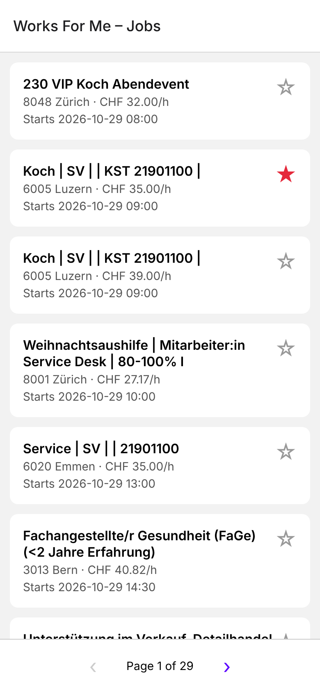
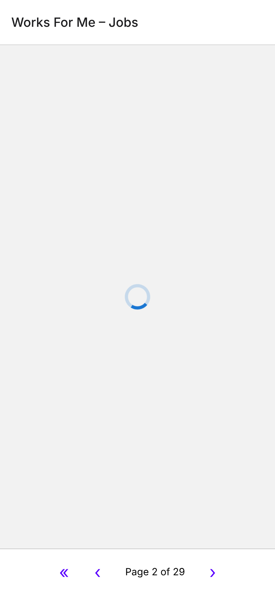
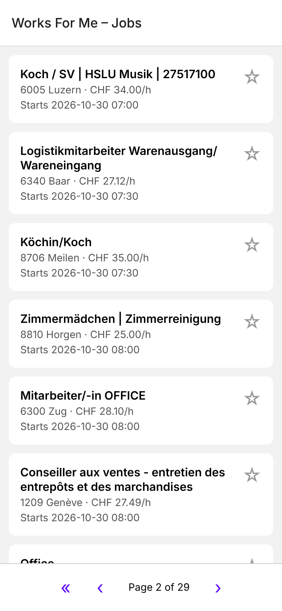
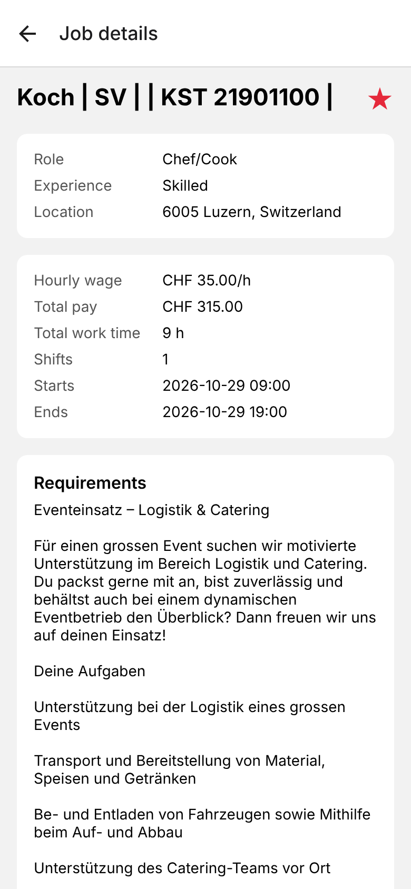
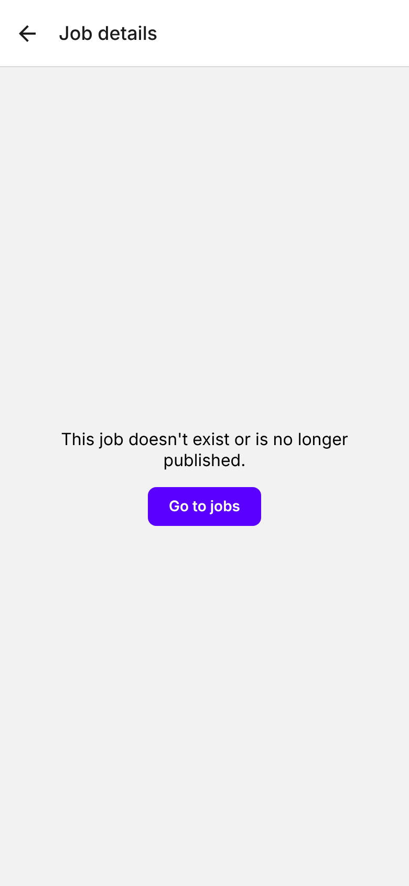

# Works For Me

Works For Me is a mobile app for browsing the public jobs listed on Coople. Open a job to see everything about it, and star the ones you like so you can find them later.

## Usage

- **Job list** shows 30 jobs per page. Use `›` / `‹` to go to the next or previous page, and `«` (shown from page 2 on) to jump back to page 1.
- **Job details** opens when you tap a job. You can also open it directly from a link to `/job/<workAssignmentId>`.
- **Favourites**: tap the star on a job in the list or on its details screen. Favourites are kept after the app restarts.

## Screenshots

Taken from the Expo web preview at phone size. In Expo Go, fonts and the header follow the platform defaults.

| Job list | Next page loading | Page 2 | Job details | Unknown job |
|---|---|---|---|---|
|  |  |  |  |  |

## Setup

Requirements: Node.js 22+ and the [Expo Go](https://expo.dev/go) app on your phone.

```bash
npm install
```

```bash
npx expo start
```

Scan the QR code with Expo Go (Android) or the Camera app (iOS).

To open a job from a link in Expo Go, use the address `npx expo start` prints. On a phone, open `exp://<ip>:8081/--/job/<workAssignmentId>` from a message or the browser. On a simulator:

```bash
npx uri-scheme open "exp://127.0.0.1:8081/--/job/<workAssignmentId>" --ios
```

In a standalone build the link is `worksforme://job/<workAssignmentId>`.

Checks:

```bash
npm test
```

```bash
npm run lint
```

```bash
npm run typecheck
```

## Architecture

```
app/                      Expo Router routes (one file per screen)
  _layout.tsx             stack navigator + favourites provider
  index.tsx               job list with page arrows
  job/[id].tsx            job details; also the /job/:id deep link
src/
  api/coople.ts           fetch wrapper: unwraps Coople's { data, error } envelope, throws ApiError
  hooks/useAsync.ts       loading / error / success state for one async call, with retry
  features/
    jobs/                 job API calls, formatting, screen components
    lookups/              English labels for numeric codes (currency, country, role, experience)
    favourites/           favourite ids in a React context, saved to AsyncStorage
```

- **Data** comes from Coople's public API through plain `fetch`, with no client library:
  - list: `GET https://www.coople.com/ch/resources/api/work-assignments/public-jobs/list?pageNum=<n>&pageSize=30`
  - details: `GET https://www.coople.com/ch/resources/api/work-assignments/public-jobs/<workAssignmentId>`
- **Error states**: both screens show loading, error-with-retry and empty or not-found states. Any non-OK response, or a body with `error: true`, counts as an error.
- **Labels** load once per app run. If a lookup fails, the screen still works and the label is left out.
- **Tests** (Jest) cover the API envelope and error handling, lookup loading, formatting, and favourite ids. There are no UI tests.

Technical decisions, the build plan, deferred ideas and the decision ledger are in [`docs/`](docs/).
